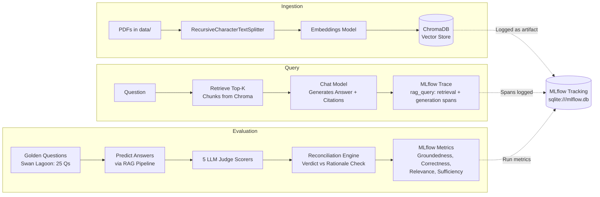
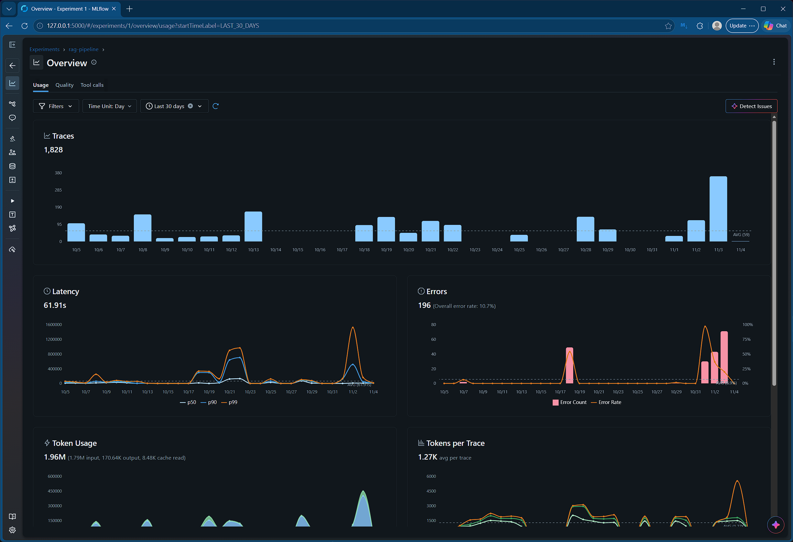
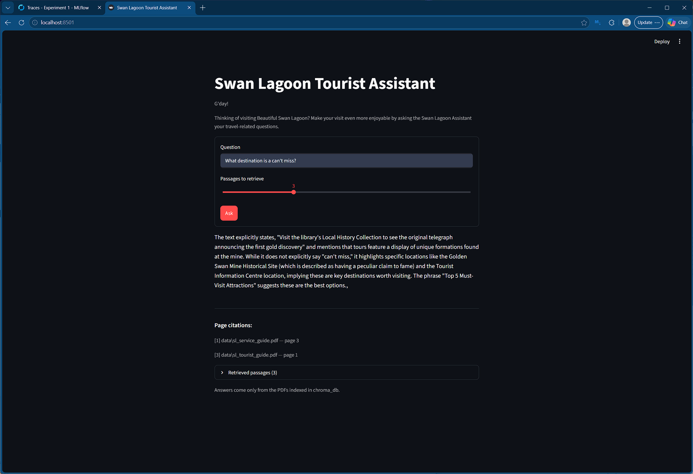

# RAGtime: Local RAG with MLflow Evaluation

A local RAG pipeline where every answer is traced, graded by five LLM judges, and corrected by a reconciliation pass that catches when judges contradict themselves. All running on your hardware.

---

## Why I Built This

I have owners manuals for my car, my kitchen appliances, my power tools. Nearly all of them are available as PDFs. But when something breaks, finding the right document (much less the answer) takes longer than the fix itself. This project lets me drop all those PDFs into one place and ask questions against them, right when I need an answer.

That's the use case. The engineering problem underneath it is harder: local RAG is easy to run but is it trustworthy? Most demos stop at "it answers." They don't measure whether the answer is grounded, whether it's correct, or whether retrieval actually helped. They also don't catch judge models contradicting their own scores.

I built this to make local RAG measurable. Every answer becomes an MLflow trace. Five judge scorers grade it. A reconciliation pass flips verdicts that contradict their own rationale. Change a config, re-run eval, watch the numbers move in MLflow. Stop once you get results that meet your expectations and keep monitoring it.

---

## The Experiment: From Hypothesis to Measured Quality

### Hypothesis
- **Null Hypothesis ($H_0$)**: Chat model size has no significant effect on factual correctness once retrieval parameters (chunk size, $k$) are optimized for the corpus.
- **Alternative Hypothesis ($H_1$)**: Chat model size creates a performance floor for factual correctness that cannot be overcome by retrieval optimization alone.

### Setup
- **Dataset**: *Swan Lagoon* (a fictitious tourist destination in Western Australia), 25 golden questions over a real multi-document corpus (visitor guides, business directory, service guide), registered as an MLflow dataset
- **Judges**: 5 MLflow GenAI scorers, 3 different judge models used
- **Default Parameter Settings**: consistent across all runs
    - EMBEDDING_MODEL = nomic-embed-text
    - JUDGE_TEMPERATURE = 0.2
    - CHUNK_SIZE (characters) = 1000
    - CHUNK_OVERLAP = 100
    - TOP_K passages to retrieve = 7
    - CHAT_TEMPERATURE = 0.2
    - MAX_TOKENS in response = 4096
- **Logging**: All run parameters, models, and settings → side-by-side columns in MLflow UI

### Results

> **Note on Judge Reliability**: While analyzing early results in MLflow, I found a frequent disconnect between the judge's rationale and its final pass/fail verdict, a common issue with smaller local models. This led to the **reconciliation step**, which automatically flips verdicts that unambiguously contradict their own reasoning so the metrics stay trustworthy. Details in [`docs/RECONCILIATION.md`](docs/RECONCILIATION.md).

Once reconciliation was in place, I could test the hypothesis against trustworthy numbers.

**The null hypothesis is rejected.** Model size sets a hard floor for factual correctness that retrieval tuning cannot overcome. The small Qwen 3.5 0.8B model capped Correctness at 0.56, hardly better than a coin toss. Moving to 12B parameters (Gemma-4-12b-QAT) raised Correctness +0.28 and Query Relevance +0.05. The smaller model wasn't using the context it retrieved.

| | **Baseline** | **Best Model** | Δ |
|---|---|---|---|
| **Chat Model** | `qwen3.5-0.8b` (0.8B) | `google/gemma-4-12b-qat` (12B) | - |
| **Judge Model** | `nvidia/nemotron-3-nano-4b` | `nvidia/nemotron-3-nano-4b` | - |
| Metric: **Retrieval Relevance** | 0.3155 | 0.3090 | **−0.01** |
| Metric: **Groundedness** | 0.8800 | **0.9067** | **+0.03** |
| Metric: **Relevance to Query** | 0.8667 | **0.9200** | **+0.05** |
| Metric: **Correctness** | 0.5611 | **0.8400** | **+0.28** |
| Metric: **Retrieval Sufficiency** | **0.9032** | 0.8800 | **−0.02** |

> Full model comparison data (6 models × 5 metrics), judge consistency tables, and related details: [`docs/RESULTS.md`](docs/RESULTS.md)

---

## RAG Architecture



**Key design decisions**: Three independent model roles (chat/embeddings/judge) on separate endpoints, ChromaDB coupled to chunk/embedding config, MLflow worker caps (3×1) to avoid flooding local judges, and reconciliation as a post-scoring pass that catches contradictions. Full details in [`docs/ARCHITECTURE.md`](docs/ARCHITECTURE.md).



---

## Run It Locally

> **TL;DR**: If you have Ollama, the only model you need is `granite4.1:3b`. Run `ollama pull granite4.1:3b` and you're ready to go. It allows you to run the entire flow on a single machine.

### 6-Step Quick Start

> Windows users: If `git` and `python` are not installed on your computer, see the prerequisites in [`QUICKSTART.md`](docs/QUICKSTART.md).

#### 1. Clone & setup environment
```bash
git clone https://github.com/SStreufert/RAGtime.git
cd RAGtime

# Create virtual environment; Windows command shown as default
python -m venv .venv        # macOS/Linux: python3 -m venv .venv

# Activate the virtual environment
.venv\Scripts\Activate.ps1  # macOS/Linux: source .venv/bin/activate
```

#### 2. Install dependencies
```bash
pip install -r requirements.txt
cp .env.example .env
```

#### 3. Open a separate terminal to start Ollama & pull models
If Ollama is not installed, see the prerequisites in [`QUICKSTART.md`](docs/QUICKSTART.md).

Then run the commands below.

```bash
ollama serve # may not be required in macOS/Linux
ollama pull nomic-embed-text
ollama pull granite4.1:3b
```

#### 4. Return to the original terminal and ingest the sample PDFs
```bash
python ingest.py
```

#### 5. Launch the Streamlit browser-based UI
```bash
python run_app.py
```

#### 6. Run a smoke test in the Streamlit chat

Open http://localhost:8501 and paste `What destination is a Must See?` → you'll see an answer with page citations from the ingested docs. A command line interface [`CLI`](docs/QUICKSTART.md) and [`API`](docs/API.md) endpoints are also available.



> You can stop here if you simply want to serve answers from your documents. Otherwise, continue below.

### Run the Evaluation (The Real Project)

#### 7. Start MLflow UI (separate terminal)
```bash
mlflow ui --backend-store-uri sqlite:///mlflow.db --port 5000
```

#### 8. Bootstrap dataset (one-time)
```bash
python scripts/import_dataset.py swan-lagoon
```

#### 9. Full eval run (25 Qs × 5 judges ≈ could take 30 min or more on local GPU)
```bash
python eval_run.py swan-lagoon
```
#### 10. View Results
1. Open http://localhost:5000 in your browser
2. Select Experiment: RAG_Experiment
3. Select Run: eval-swan-lagoon
4. Select Evaluation tab (to see Pass/Fail metrics and Judge Rationales)
5.  Or click the "rag_query" trace in the Table to see the full retrieval/generation lifecycle

### What's Next

**Full guide with troubleshooting, CLI flags, and model-swapping**: see [`docs/QUICKSTART.md`](docs/QUICKSTART.md)

**Bring your own documents**: drop your PDFs into `data/`, fill in the golden-question template `data/my_documents_golden_questions.json`, then `python scripts/import_dataset.py` and `python eval_run.py my-documents`. Full walkthrough: [`docs/EVALUATION.md`](docs/EVALUATION.md).

---

## Roadmap Highlights

Ordered by production impact (see [`docs/ROADMAP.md`](docs/ROADMAP.md) for full list with rationale):

1. **Multi-Format Ingestion** (Markdown, HTML, Text, Word): real-world corpora aren't PDF-only; users must convert everything today.
2. **Cross-Encoder Reranker**: retrieval relevance caps at ~0.30; a reranker prunes distractors before the LLM sees them, directly improving correctness.
3. **FAQ-to-Golden-Questions Pipeline**: closes the loop from production traffic → logged FAQs → human curation → golden dataset → eval regression.

---

## Deep Dives

For further information on this project, see the documentation [`README.md`](docs/README.md).

**Vocabulary**: See [`GLOSSARY.md`](GLOSSARY.md) for the controlled terminology used across this project (corpus, dataset, golden question, judge, scorer, assessment, verdict, rationale, reconciliation, endpoint check).

---

## Credits

- **[gotsun777/Ollama_RAG](https://github.com/gotsun777/Ollama_RAG)**: Foundational repo; forked and got running first. All MLflow-related work (tracing, evaluation, reconciliation) and the experiment workflow built on top here.
- **[pixegami/simple-rag-pipeline](https://github.com/pixegami/simple-rag-pipeline)**: Source of the sample PDF corpus (`data/*.pdf`) and the original golden-question dataset this project's evaluations grew from.

---

*Built to prove: local RAG can be measured, not just demoed.*
