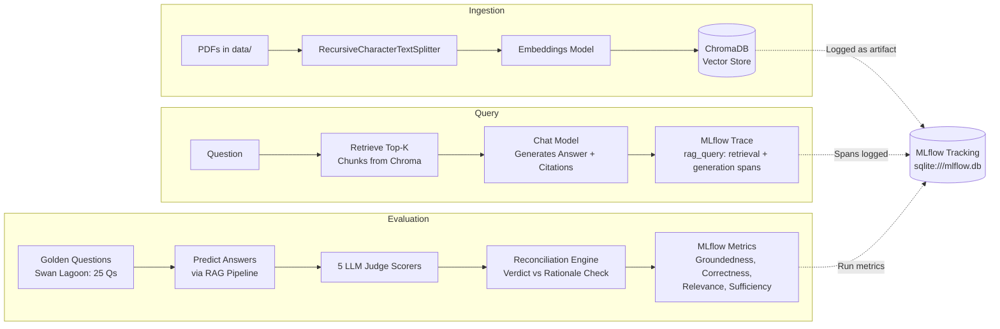

# Architecture Deep Dive

This document covers the design decisions, component responsibilities, and technology choices behind the pipeline. The three stages (ingestion, query, evaluation) are described first, then the reasoning behind each major choice.

---

## Architecture Diagram

The pipeline has three stages (ingestion, query, and evaluation) with MLflow tracking threaded through all of them. Ingestion reads PDFs, splits them, embeds the chunks, and persists them to Chroma. Queries retrieve top-K chunks, feed them to the chat model, and emit an MLflow trace with `retrieval` and `generation` spans. Evaluation runs golden questions through the pipeline, scores the traces with five LLM judges, and reconciles verdicts against rationales.



---

## Component Responsibilities

The pipeline is further split into seven areas of responsibility. Every component reads its configuration from `config.settings`; nothing is hardcoded.

| Component | File | Responsibility |
|-----------|------|----------------|
| **Config** | `config.py` | Centralized pydantic-settings; three independent model roles (embeddings, chat, judge) with separate endpoints |
| **Ingestion** | `ingest.py` | PDF → chunk → embed → Chroma; logs MLflow ingestion run with `chunk_samples.json` |
| **RAG Pipeline** | `rag.py` | Retrieve → generate → trace (`retrieval` + `generation` spans); CLI entry point |
| **Evaluation** | `eval_run.py`, `evaluate.py` | Registered dataset runs + ad-hoc JSON eval; capped MLflow workers for local judges |
| **Reconciliation** | `eval_consistency.py` | Negation-aware rationale classification; flips contradictory verdicts; flags hedged rationales |
| **Health** | `healthcheck.py` | Launch-time endpoint verification (chat, embeddings, judge); standalone `python healthcheck.py` probe |
| **Interfaces** | `app.py`, `api.py` | Streamlit chat UI + FastAPI REST; both probe endpoints on launch |

---

## Key Design Decisions & Trade-offs

Each choice below trades something for reliability. The vector store is bound to its chunking and embedding settings so experiments never silently corrupt each other. MLflow's eval fan-out is capped so a single local judge isn't flooded. Model roles are split so embeddings, chat, and the judge can live on different machines. Reconciliation runs after scoring as a safety net for judges that contradict themselves. Every launch verifies its endpoints first, so a misconfiguration fails fast instead of mid-query.

| Decision | Trade-off | Why It Matters |
|----------|-----------|----------------|
| **ChromaDB coupled to `(chunk_size, chunk_overlap, embedding_model)`** | Re-ingest requires deleting `chroma_db` when any of the three changes | Forces explicit experiment versioning; prevents silent index corruption. Archive folders (`chroma_db_500-100`, etc.) can make comparison trivial. |
| **MLflow worker caps (3 predict × 1 scorer)** | Slower eval runs | Prevents flooding a single local judge (Ollama/LM Studio); avoids 300s gateway timeouts and stalled runs at 0%. |
| **Three independent model roles** | More config surface area | Embeddings, chat, and judge can run on different machines/models. Enables "small embeddings + big judge" or "local chat + remote judge" topologies. |
| **Reconciliation as post-scoring pass** | Adds latency; doesn't fix root cause (small judge) | Catches ~15-20% judge contradictions automatically. Correction count becomes a *metric for judging the judge*; roadmap: larger judge → fewer corrections. |
| **Launch-time endpoint health checks** | Adds ~2s to every startup | Fails fast with per-role messages instead of cryptic mid-query errors. Valuable for CI and multi-machine setups. |

---

## Tech Stack

LangChain is used throughout: `RecursiveCharacterTextSplitter` for chunking, `ChatOpenAI`/`OpenAIEmbeddings` as the OpenAI-compatible chat and embedding clients, `ChatPromptTemplate`/`StrOutputParser` for prompt and output handling, and `Chroma` as the vector store integration. MLflow tracing is done directly through `mlflow.tracing.fluent.start_span`, not via a LangChain callback handler, and the pipeline composes the retrieval→generation chain manually rather than using `RetrievalQA`.

| Layer | Technology | Why |
|-------|------------|-----|
| **LLM Runtime** | Ollama / LM Studio (OpenAI-compatible) | Local-first; no cloud API keys; swap models in `.env` |
| **Orchestration** | LangChain | Text splitters, OpenAI-compatible chat/embedding clients, prompt templates, Chroma integration |
| **PDF Parsing** | `pypdf` | Extracts page text for ingestion |
| **Vector Store** | ChromaDB | Local, persistent, simple API; good enough for this scale |
| **Tracking & Eval** | MLflow GenAI | Traces, scorers, datasets, UI: industry standard |
| **Config** | pydantic-settings | Type-safe, `.env`-driven, validation out of the box |
| **CLI** | Typer | Modern, type-hinted CLIs for `eval_run.py` / `evaluate.py` |
| **UI** | Streamlit | Rapid chat interface with citation rendering |
| **API** | FastAPI | REST endpoint with `/health` and `/ask` |
| **Testing** | pytest | Offline-first; temp MLflow store via fixture |

---

## Project Structure

The root holds the pipeline modules and CLI entry points. All scratch scripts, outputs, and one-off analyses have been removed to keep the repository clean. The `scripts/` folder contains only documented tools; `data/` holds source PDFs and goldens; `docs/` contains deep-dive documentation; `tests/` is an offline-first pytest suite.

```
├── config.py                      # Settings (pydantic-settings), .env loading, judge env routing
├── tracker.py                     # MLflow wrapper (soft import), log_ingestion(), log_query(), eval_run_params()
├── ingest.py                      # PDF → chunk → embed → Chroma (logs ingestion run)
├── rag.py                         # Query pipeline: retrieve, generate, trace (retrieval + generation spans)
├── eval_run.py                    # Eval runs over registered dataset presets (Typer CLI)
├── evaluate.py                    # Eval runs over JSON dataset files (Typer CLI)
├── eval_consistency.py            # Verdict/rationale reconciliation engine
├── healthcheck.py                 # Launch-time endpoint check + standalone CLI
├── run_app.py                     # Streamlit wrapper (probes endpoints, --no-track flag)
├── app.py / api.py                # Streamlit UI / FastAPI REST endpoint
├── scripts/
│   ├── reconcile_assessments.py   # Retroactive reconciliation of past MLflow runs (--run-id)
│   └── import_dataset.py          # Register golden questions as MLflow dataset
├── data/
│   ├── sl_booklet.pdf             # Sample PDF corpus
│   ├── sl_business_directory.pdf  # Sample PDF corpus
│   ├── sl_service_guide.pdf       # Sample PDF corpus
│   ├── sl_tourist_guide.pdf       # Sample PDF corpus
│   ├── swan_lagoon_golden_questions.json   # 25 golden Q&A pairs for evaluation
│   └── my_documents_golden_questions.json  # Additional golden questions
├── docs/
│   ├── ARCHITECTURE.md            # This file (diagram, responsibilities, tradeoffs)
│   ├── EVALUATION.md              # From PDFs to scored eval runs, dataset registration
│   ├── MLFLOW.md                  # MLflow logging reference: params, metrics, artifacts
│   ├── RECONCILIATION.md          # Verdict/rationale corrections, guarantees
│   └── images/*.png               # Diagram images (overview, trace, results, etc.)
├── tests/                          # pytest suite (offline-first via temp SQLite MLflow)
├── GLOSSARY.md                     # Domain vocabulary
├── .env.example                    # Template for all config variables
└── README.md                       # Project overview and quickstart
```

---

## Settings

All configuration flows through `config.py`: a single `pydantic-settings` `Settings` class that reads `.env` (which overrides the code defaults). Every setting below is a field on that class; the defaults are what the code actually uses when `.env` doesn't set them. Three model roles (embeddings, chat, judge) each have their own base URL, API key, and model id, and the judge role falls back to the chat endpoint when not explicitly configured.

| Variable | Default | Description |
|----------|---------|-------------|
| `CHAT_BASE_URL` | `http://localhost:11434/v1` | OpenAI-compatible chat endpoint (must include `/v1`) |
| `EMBEDDINGS_BASE_URL` | `http://localhost:11434/v1` | OpenAI-compatible embeddings endpoint |
| `JUDGE_BASE_URL` | *(falls back to `CHAT_BASE_URL`)* | Optional separate judge endpoint |
| `CHAT_API_KEY` | `lm-studio` | Ignored by local backends; must be non-empty for the OpenAI client |
| `EMBEDDINGS_API_KEY` | `lm-studio` | Ignored by local backends; must be non-empty for the OpenAI client |
| `JUDGE_API_KEY` | *(falls back to `CHAT_API_KEY`)* | Optional separate judge API key |
| `EMBEDDING_MODEL` | `nomic-embed-text` | Embedding model id as the endpoint reports it |
| `CHAT_MODEL` | `granite4.1:3b` | Chat/generation model id |
| `JUDGE_MODEL` | `granite4.1:3b` | Model used by the judge scorers |
| `JUDGE_TEMPERATURE` | `0.2` | Judge temperature (MLflow scorers use this) |
| `SKIP_ENDPOINT_CHECK` | `false` | Set to `1` to skip the launch-time endpoint availability check |
| `CHUNK_SIZE` | `1000` | Text chunk size in characters |
| `CHUNK_OVERLAP` | `100` | Overlap between chunks |
| `TOP_K` | `7` | Number of passages to retrieve |
| `TEMPERATURE` | `0.2` | LLM temperature |
| `MAX_TOKENS` | `4096` | Max completion tokens |
| `MLFLOW_TRACKING_URI` | `http://localhost:5000` | MLflow backend (file store, SQLite, or an MLflow server URL) |
| `MLFLOW_EXPERIMENT_NAME` | `rag-pipeline` | MLflow experiment name |
| `SCORER_TIMEOUT` | `0.0` | Per-scorer timeout in seconds (`0` = disabled) |
| `CHROMA_DIR` | `./chroma_db` | Vector store directory |
| `DATA_DIR` | `./data` | Directory of source PDFs |

> **Note**: The Chroma store is coupled to `CHUNK_SIZE`, `CHUNK_OVERLAP`, and `EMBEDDING_MODEL`; changing any of them requires deleting `CHROMA_DIR` before re-ingesting, since `Chroma.from_documents` appends rather than replaces.

---

## Original Repo vs. Current Project

The original [gotsun777/Ollama_RAG](https://github.com/gotsun777/Ollama_RAG) was a working prototype with four files: PDF ingestion, a basic RAG query, a minimal Streamlit UI, and a minimal FastAPI endpoint. Everything below was built on top of that foundation. The four original files were enhanced or rewritten, and 27 new files were added across pipeline, evaluation, testing, and documentation.

### Key Architectural Additions

1. **Three-role model topology**: Chat, embeddings, and judge can each target different endpoints/models (enables "small embeddings + large judge" or "local chat + remote judge").

2. **MLflow GenAI evaluation as first-class citizen**: Every answer traced; 5 LLM-judge scorers grade retrieval groundedness, relevance, correctness, sufficiency, query relevance; worker caps prevent local judge flooding.

3. **Reconciliation engine**: Post-scoring pass that reads each judge's rationale, classifies its *actual* conclusion (negation-aware, rightmost-match), flips verdicts that contradict their own reasoning (~15-20% correction rate), flags hedged rationales for review. Correction count becomes a metric for judging the judge.

4. **Launch-time health checks**: Probes all configured endpoints via `/v1/models`, verifies model presence, fails fast with per-role hints. Important for CI and multi-machine deployments.

5. **Offline-first testing**: Pytest suite redirects MLflow to throwaway SQLite store; most tests run without any model servers.

6. **Structured citations**: LLM emits `[n]` markers + `USED_SOURCES:` line; pipeline parses, validates, strips for clean display; UI renders "Sources used" with page numbers from parsed indices.

7. **Retroactive reconciliation**: `scripts/reconcile_assessments.py --run-id <id> [--dry-run]` fixes past runs; tags run with correction counts.

8. **Expanded documentation**: `docs/` folder includes instructions for installing and using this solution as well as design details.

### Files Enhanced (Original → Current)

| File | Changes & Enhancements |
|------|------------------------|
| `ingest.py` | **Enhanced**: Added MLflow tracking, config-driven params, artifact logging. |
| `rag.py` | **Rewritten**: Production-grade tracing, citations, config, reliability. |
| `app.py` | **Enhanced**: Health checks, citations, UX, tracking control. |
| `api.py` | **Enhanced**: Health, tracking, config, production readiness. |

### Files Added (Not in Original)

| Category | File | Purpose / Summary |
|----------|------|-------------------|
| **Core Pipeline** | `config.py` | Centralized pydantic-settings; three independent model roles (chat/embeddings/judge) with separate base URLs, API keys, models; judge env routing for MLflow scorers |
| **Core Pipeline** | `tracker.py` | MLflow wrapper (soft import), `log_ingestion()`, `log_query()`, `eval_run_params()` for consistent run columns, `RAG_DISABLE_TRACKING` env toggle |
| **Core Pipeline** | `healthcheck.py` | Launch-time probe of `/v1/models` per role, verifies configured model is served, per-role success/fail with actionable hints, success caching, standalone `python healthcheck.py` (GREEN/RED, exit 0/1) |
| **Core Pipeline** | `run_app.py` | Streamlit wrapper: probes endpoints before UI load, `--no-track` flag, Windows encoding fix |
| **Evaluation & Reconciliation** | `eval_run.py` | Typer CLI for registered dataset presets (`swan-lagoon`, `my-documents`), MLflow GenAI evaluate with 5 scorers, worker caps (3×1), validation, reconciliation hook, failure exit codes |
| **Evaluation & Reconciliation** | `evaluate.py` | Typer CLI for ad-hoc JSON dataset eval (`query`, `batch`, `questions` commands), reuses eval_run scorers & reconciliation |
| **Evaluation & Reconciliation** | `eval_consistency.py` | Negation-aware rationale classification engine; flips contradictory verdicts (`yes`↔`no`), flags hedged rationales (`partially`, `not entirely`), re-logs corrected metrics, tags run (`reconciled`, `reconcile_corrected`, `reconcile_uncertain`), retroactive `scripts/reconcile_assessments.py` |
| **Evaluation & Reconciliation** | `scripts/reconcile_assessments.py` | Retroactive reconciliation of past runs; tags run with correction counts |
| **Evaluation & Reconciliation** | `scripts/import_dataset.py` | Register golden questions as MLflow dataset (one-time setup; --force to refresh) |
| **Core Pipeline** | `golden_questions.py` | Shared golden question loading/parsing for eval scripts |
| **Testing** | `tests/` | Full pytest suite: offline-first (temp SQLite MLflow), fixtures for config/judge env, 11 test modules covering config, tracker, healthcheck, eval_consistency (verbatim rationales from real traces), eval_run, evaluate, API, soft imports |
| **Documentation** | `docs/` | 8 deep-dive docs: ARCHITECTURE, API, EVALUATION, MLFLOW, QUICKSTART, RECONCILIATION, RESULTS, ROADMAP + diagrams in `docs/images/` |
| **Documentation** | `README.md` | Project overview, quickstart, and usage guide at repository root |
| **Data & Config** | `data/swan_lagoon_golden_questions.json` | 25 golden questions with expectations over real multi-doc corpus (Swan Lagoon) |
| **Data & Config** | `data/my_documents_golden_questions.json` | Additional golden questions for custom document evaluation |
| **Data & Config** | `AGENTS.md` | Agent instructions for local RAG development |
| **Data & Config** | `GLOSSARY.md` | Domain vocabulary |

| **Data & Config** | `requirements.txt` | Pinned dependencies |
| **Data & Config** | `.env.example` | Template for all config variables |

| Category | Lines of Code (est.) |
|----------|----------------------|
| **Core Pipeline** | ~2,800 |
| **Evaluation & Reconciliation** | ~2,800 |
| **Testing** | ~1,500 |
| **Documentation** | ~3,800 |
| **Data & Config** | ~600 |

**Total new/enhanced code: ~11,500 lines** across 35+ new files.

---

## Deep Dives

For further information on this project, see the documentation [`README.md`](README.md).

**Vocabulary**: See [`../GLOSSARY.md`](../GLOSSARY.md) for the controlled terminology used across this project (corpus, dataset, golden question, judge, scorer, assessment, verdict, rationale, reconciliation, endpoint check).
