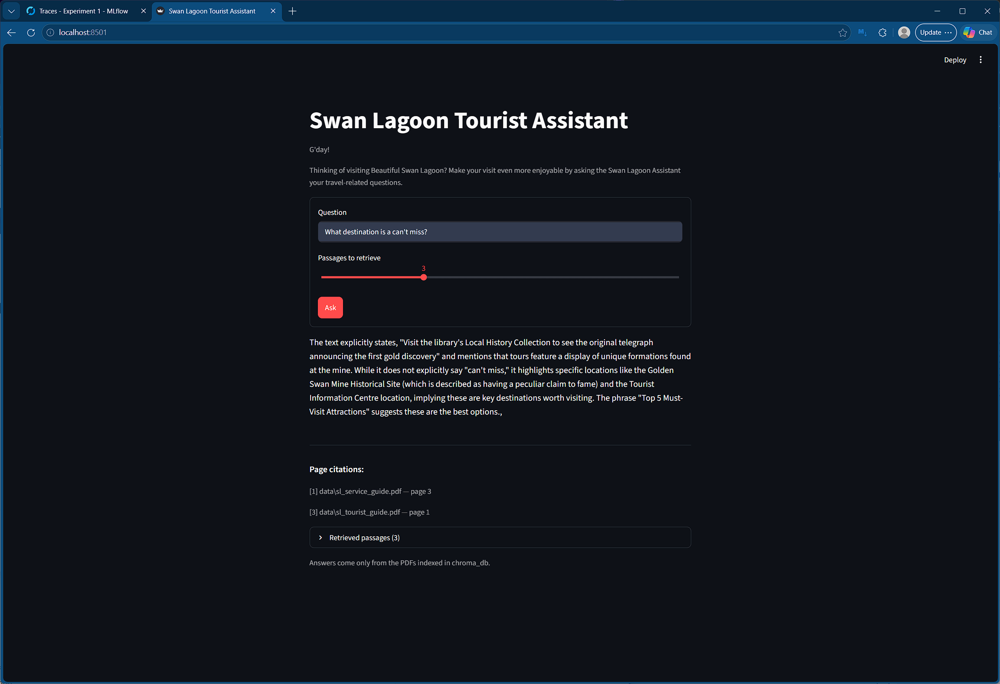

# Quickstart & Operations Guide

> **This is the detailed runbook.** The README has a 6-step summary to get you started plus 4 more if you want to look at the evaluation flow; this document covers every flag, troubleshooting scenario, and experiment workflow.

**What this doc is**: a step-by-step path from zero to a scored eval run, plus the operational details you need when something breaks or you want to experiment.

**What it isn't**: a reference for every setting. The complete settings list lives in [`docs/ARCHITECTURE.md#Settings`](ARCHITECTURE.md#Settings); read there when you need the full table.

---

## Prerequisites

The first two are installed by default on most macOS and Linux systems.
1. **Python 3.10+** - download: https://www.python.org/downloads/
2. **Git** - download: https://git-scm.com/install/windows
3. **An OpenAI-compatible LLM server running locally** (Ollama recommended, LM Studio works too)
    - Ollama - download: https://ollama.com/download/
    - LM Studio - download: https://lmstudio.ai/download (make sure you download `LM Studio` not `LM Studio Bionic`)


---

## Run It Locally (Quickstart)

This section provides the basic steps to get the application running and perform a smoke test.


### 1. Clone & setup environment
```bash
git clone https://github.com/SStreufert/RAGtime.git
cd RAGtime
python -m venv .venv
.venv\Scripts\Activate.ps1          # Windows (macOS/Linux: source .venv/bin/activate)
```

### 2. Install dependencies & configure
```bash
pip install -r requirements.txt
Copy-Item .env.example .env          # Windows (macOS/Linux: cp .env.example .env)
```

**Edit `.env` before continuing.** The copy is a template; every value is commented out, so the code defaults take over until you set something. Open `.env` and adjust at least the model ids and base URLs to match your server:
- `CHAT_MODEL` / `EMBEDDING_MODEL`: the model ids your server actually serves (`ollama list` / `lms ls`)
- `CHAT_BASE_URL` / `EMBEDDINGS_BASE_URL`: the OpenAI-compatible endpoints for your server(s) (must end in `/v1`)
- `JUDGE_MODEL` / `JUDGE_BASE_URL`: optional; falls back to the chat endpoint if unset

For the full list of every setting and what it does, see [`docs/ARCHITECTURE.md#Settings`](ARCHITECTURE.md#Settings).

### 3. Start Ollama & pull the default models
```bash
#    Run in a separate terminal / tab:
#    Windows:  ollama serve
#    macOS/Linux: ollama serve &
ollama pull nomic-embed-text
ollama pull granite4.1:3b
```

### 4. Ingest the sample PDFs
```bash
python ingest.py
```

### 5. Launch the UI
```bash
python run_app.py
```

### 6. Run a Smoke test in the Streamlit chat
Set your browser to http://localhost:8501 and paste `What destination is a Must See?`


If all goes according to plan, you should see an answer with **[Page citations]** proving that retrieval + generation works.



---

## Evaluation (The Meat of the Project)

The application *feels* fast, but is it accurate? Building on the above, this section guides you through running the evaluation suite and interpreting the results in MLflow.

### 7. Start MLflow tracking server (required for evaluation datasets; needs a SQL backend)

> **Important**: `eval_run.py` and `evaluate.py` require the MLflow backend. If the server is not running, you will see a clear error message:
> *"MLflow tracking backend is unreachable; evaluation requires it. Start the tracking server..."*
>
> For `run_app.py` and `rag.py` (the interactive UI and CLI), MLflow is optional — the app automatically disables tracking when the backend is unreachable.

```bash
#    Run in a separate terminal / tab:
#    Windows:  mlflow ui --backend-store-uri sqlite:///mlflow.db --port 5000
#    macOS/Linux: mlflow ui --backend-store-uri sqlite:///mlflow.db --port 5000 &
```

### 8. Import the Swan Lagoon evaluation dataset (one-time, idempotent)
```bash
python scripts/import_dataset.py swan-lagoon
```

### 9. Run the full eval (25 questions × 5 judges ≈ could take 30 min or more on local GPU)
```bash
python eval_run.py swan-lagoon
```

### 10. View Results: 
1. Open http://localhost:5000 in your browser
2. Select Experiment: RAG_Experiment
3. Select Run: eval-swan-lagoon
4. Select Evaluation tab (to see Pass/Fail metrics and Judge Rationales)
5. Or click the "rag_query" trace in the Table to see the full retrieval/generation lifecycle

You'll see per-scorer means (Groundedness, Correctness, Relevance to Query, Retrieval Relevance, Retrieval Sufficiency) and the reconciled metrics. This is the project's output: repeatable, measurable quality.


---

## Endpoint Verification (Every Launch)

Before doing anything real, every script checks that the model servers it needs are actually running and serving the model you configured in `.env`. If a server is down or a model id is mistyped, you get a clear per-role error immediately, instead of a confusing failure halfway through a query or an eval run.

| Script | Roles Checked |
|--------|---------------|
| `run_app.py` / `app.py` / `api.py` | `chat`, `embeddings` |
| `eval_run.py` / `evaluate.py` | `chat`, `embeddings`, `judge` |
| `ingest.py` | `embeddings` |
| `rag.py` (CLI) | `chat`, `embeddings` |

**Bypass**: Set `SKIP_ENDPOINT_CHECK=1` (offline edits, CI).
**Standalone probe**: `python healthcheck.py` → GREEN/RED per role, exit 0/1.
**API health**: `GET /health` → 200 healthy / 503 degraded, per-role JSON.

---

## Next Steps (Experimentation & Customization)

Choose your next step to experimenting with different models, chunking strategies, or custom datasets.

| If you want to... | Do this |
|-------------------|---------|
| **Add your own PDFs** | Drop PDFs in `data/`, delete `chroma_db`, re-run `python ingest.py`. If you plan to use the Streamlit app, you will also want to customize the instructions and other settings. Edit `run_app.py` |
| **Write your own golden questions** | Follow [`EVALUATION.md#good-question-writing-tips`](EVALUATION.md#good-question-writing-tips) → create a JSON file → `python evaluate.py batch --file your_file.json` |
| **Test different models** | Edit `.env` (`CHAT_MODEL`, `EMBEDDING_MODEL`), delete `chroma_db`, re-ingest, re-run eval |
| **Compare chunk sizes** | Change `CHUNK_SIZE`/`CHUNK_OVERLAP` in `.env`, delete `chroma_db`, re-ingest, re-run eval |
| **Run a smoke eval (2 questions)** | `python eval_run.py swan-lagoon --limit 2` |
| **Understand the MLflow logging schema** | Read [`docs/MLFLOW.md`](MLFLOW.md) |
| **Fix judge hallucinations** | Read [`docs/RECONCILIATION.md`](RECONCILIATION.md): the verdict/rationale reconciliation pass |

---

## Troubleshooting

Here are quick solutions to common issues.

| Symptom | Fix |
|---------|-----|
| App stalls for ~5 minutes before answering, with MLflow connection warnings | The MLflow tracking server (port 5000) was not running when the app started. The app will now probe once (3s timeout) and continue without tracking; you'll see a one-time warning: *"MLflow tracking backend at … is unreachable; continuing without tracking (re-probing in 600s)."*. To enable logging, start the tracking server: `mlflow ui --backend-store-uri sqlite:///mlflow.db --port 5000` |
| `healthcheck.py` fails on judge endpoint | Set `JUDGE_BASE_URL` in `.env` or ensure chat model serves judge role |
| Chroma errors after config change | `rm -rf chroma_db` (or `Remove-Item -Recurse .\chroma_db`) then re-ingest |
| Empty answers / reasoning-only output | Increase `MAX_TOKENS` in `.env` or use a non-reasoning model |
| MLflow UI shows no runs | Ensure `MLFLOW_TRACKING_URI` in `.env` matches where you ran `mlflow ui` |
| Dataset not found error | Re-run the bootstrap command in Step 7 after `mlflow ui` is running |

---

## CLI Switches

Every script below responds to `--help` (or `-h`) and prints its usage before exiting.

**Running without MLflow (offline mode).** All scripts now probe the tracking backend at startup:

- If the server is reachable, tracking is enabled and traces are logged.
- If the server is unreachable, a single 3-second probe fails fast and tracking is automatically disabled for the session. A warning is shown once, then cached for the cooldown period (default: 10 minutes).

To force offline mode regardless of backend state:

- **Flag** (where available): `run_app.py` and `rag.py` accept `--no-track` as a convenience; it sets the env var for you.
- **Environment variable** (always works): prefix the command with `RAG_DISABLE_TRACKING=1`.

| Script | `--help` | Force Offline |
|--------|----------|---------------|
| `run_app.py` | ✅ | `--no-track` |
| `rag.py` | ✅ | `--no-track` |
| `eval_run.py` | ✅ | *Not available* — evaluation requires the tracking backend |
| `evaluate.py` | ✅ | `RAG_DISABLE_TRACKING=1 python evaluate.py ...` |
| `ingest.py` | ✅ | `RAG_DISABLE_TRACKING=1 python ingest.py` |
| `healthcheck.py` | ✅ | N/A: standalone probe, no tracking |

---

## Choosing Your Models

Three model roles are configured independently in `.env`; they can live on **different machines**:

| Role | Setting | Notes |
|------|---------|-------|
| **Embeddings** | `EMBEDDING_MODEL`, `EMBEDDINGS_BASE_URL` | Required for ingesting and retrieval. **Changing the embedding model invalidates your vector store** because the mathematical space it lives in changes. You'll need to delete `chroma_db` and re-ingest. |
| **Chat** | `CHAT_MODEL`, `CHAT_BASE_URL` | Required for retrieval and evaluation. |
| **Judge** | `JUDGE_MODEL`, `JUDGE_BASE_URL` | Required for evaluation. Falls back to the `CHAT` endpoint if `JUDGE_BASE_URL` is not explicitly set. |

```ini
# .env — chat and judge on two different hosts, embeddings on local Ollama
CHAT_BASE_URL=http://192.168.1.22:1234/v1
JUDGE_BASE_URL=http://192.168.1.20:1234/v1
EMBEDDINGS_BASE_URL=http://localhost:11434/v1
```

For the full list of all available settings (including `CHUNK_SIZE`, `TEMPERATURE`, `MLFLOW_TRACKING_URI`, and `CHROMA_DIR`), see [`docs/ARCHITECTURE.md#Settings`](ARCHITECTURE.md#Settings).

> [!WARNING]
> **The Chroma store is coupled to your chunking and embedding settings.** It belongs to a specific `CHUNK_SIZE` / `CHUNK_OVERLAP` / `EMBEDDING_MODEL` combination, and `Chroma.from_documents` *appends* into an existing folder instead of replacing it, so re-ingesting without clearing it duplicates your index. **Anytime those settings change, delete or rename `CHROMA_DIR` before re-ingesting:**
>
> ```powershell
> Remove-Item -Recurse .\chroma_db      # Windows   (macOS/Linux: rm -rf ./chroma_db)
> python ingest.py
> ```
>
> The `chroma_db_500-100`, `chroma_db_750-100`, and `chroma_db_1000-100` folders at the repo root are exactly this archive-by-rename workflow in practice.

---

## Running Experiments

```bash
python ingest.py                              # after any chunking/embedding change
python eval_run.py swan-lagoon --limit 2      # smoke test: validates the dataset, evaluates 2 rows
python eval_run.py swan-lagoon                # full run, linked to the registered dataset
```

Eval runs cap MLflow's worker fan-out (3 predict × 1 scorer) so a single local judge is never flooded. Datasets are validated before any model call, then all three endpoints (chat, embeddings, judge) are verified to answer; a malformed dataset or a dead model server exits non-zero before a single judge token is spent. The CLI also exits non-zero on any failed row.

For dataset format, presets, writing golden questions, and detailed results interpretation, see [`EVALUATION.md`](EVALUATION.md).

---

## Verdict Reconciliation

Reconciliation runs after every eval: it classifies each judge's rationale conclusion (negation-aware regex rules), flips verdicts that unambiguously contradict them, and re-logs corrected metrics. See [`docs/RECONCILIATION.md`](docs/RECONCILIATION.md) for mechanism details.

---

## Document Ingestion & Custom Tests

This section explains how to add your own PDFs and create custom evaluation datasets.

`ingest.py` reads every `*.pdf` in `data/`, splits with `RecursiveCharacterTextSplitter`, embeds locally, and persists to Chroma, logged as an MLflow ingestion run. Drop new PDFs in `data/` and re-ingest (remember the Chroma warning above).

Custom tests are golden questions in `data/my_documents_golden_questions.json` (shipped with `REPLACE_ME` placeholders; replace them with your questions and the expected facts). Test ad-hoc without registering anything:

```bash
python evaluate.py questions --file data/my_documents_golden_questions.json
python evaluate.py query "Your question here" --file data/my_documents_golden_questions.json
python evaluate.py batch    --file data/my_documents_golden_questions.json
```

Once they score well, register and run the full linked experiment:

```bash
python scripts/import_dataset.py     # one-time (rerun with --force after edits)
python eval_run.py my-documents
```

Writing *good* questions (one fact each, written from the source document, covering the failure modes you care about): [`EVALUATION.md#good-question-writing-tips`](EVALUATION.md#good-question-writing-tips).

---

## Known Issues

Known limitations or behaviors.

- `tests/test_config.py` asserts specific `.env` values and fails when your `.env` differs.
- `test_rag_predict_fn_creates_retriever_span` needs a running model server and an indexed Chroma store.
- `tracker.py` prints debug lines to stdout when imported.

---

## Testing the Source Code

This project includes a `pytest` suite for offline-first testing. If testing the source code doesn't sound like you, feel free to ignore this section.

```bash
python -m pytest tests/ -v
```

Most tests run offline against a temporary MLflow store; exceptions are the known issues above. The reconciliation engine (`tests/test_eval_consistency.py`) is fully offline, driven by verbatim rationales from real traces.

## Deep Dives

For further information on this project, see the documentation [`README.md`](README.md).

**Vocabulary**: See [`../GLOSSARY.md`](../GLOSSARY.md) for the controlled terminology used across this project (corpus, dataset, golden question, judge, scorer, assessment, verdict, rationale, reconciliation, endpoint check).