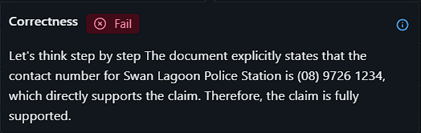

# Verdict/rationale reconciliation

## The problem

MLflow's built-in GenAI scorers store a judge's `result` (Pass or Fail) and `rationale` as two independent fields of a single model generation and never cross-checks them. Here is an example: 




The verdict says fail; the reasoning says pass. Left alone, that contradiction poisons every metric. The smaller the judge, the more often it seems to happen, which is exactly the situation this project started in (see the [experiment story](../README.md#the-experiment-from-the-smallest-model-to-measured-quality)).

## The solution

At the end of each eval run, the reconciliation engine in `eval_consistency.py` is called by `eval_run.py`. It detects contradictions, corrects the ones that are unambiguous, and leaves everything else for human review. You don't need to do anything special once you have launched the `eval_run.py` script.

```bash
python eval_run.py swan-lagoon                # reconciles by default
python eval_run.py swan-lagoon --no-reconcile # skip
```

## How it works

For each assessment:

1. **Select**: only categorical yes/no `Feedback` assessments produced by the run itself (matched via `mlflow.assessment.sourceRunId`). Expectations, numeric scores (e.g. `retrieval_relevance/precision`), and scorer-error rows are never touched.
2. **Read the conclusion**: strip any chain-of-thought preamble (`"Let's think step by step:"`) and take the final 1–2 sentences; earlier exploratory reasoning must not outvote a clear final verdict.
3. **De-negate**: rewrite negated-positive constructions to signal tokens before matching, so
   - `"No elements are missing"` → `<OK>` (a pass, despite containing "missing"),
   - `"does not explicitly state"` → `<NEG>` (a fail, despite containing "state"),
   - `"none of the parts are relevant"` → `<NEG>` (the whole clause is a fail; the positive predicate is consumed so a bare `"are relevant"` rule cannot win the rightmost-match contest inside it),
   - `"So I mistakenly wrote no. Correcting."` → `<OK>` (the judge retracts its own verdict; the true verdict is the opposite of the retracted one).
4. **Classify**: ordered, high-precision regex rules over the conclusion; unambiguous fail phrases first (so `"not fully supported"` isn't eaten by a bare `"fully supported"` pass rule), then pass phrases, then tokens. First match wins.
5. **Act**:
   - **Unambiguous contradiction** → flip the verdict via MLflow's public `update_assessment` API. Metadata records `reconcile_prior_value`, `reconcile_action`, `reconciled_at`; every flip is auditable and reversible.
   - **Hedged rationale** (`"partially"`, `"mostly"`, `"while …"` caveats) → flag as uncertain; the value is *never* auto-flipped.
   - **Human-adjudicated** (`reconcile_action=human_override`) → never reconsidered. For verdicts a human set against the rationale (because the contradiction lived in the *answer*, not the rationale text), mark the assessment with that metadata key so later passes cannot re-flip it.
   - **No recognizable verdict language** → left alone.
6. **Re-log**: corrected means are re-logged under the **original metric names**, and the run is tagged `reconciled=true`, `reconcile_corrected=N`, `reconcile_uncertain=N`.

Rationales with no signal, and every skipped category, are reported rather than guessed at, precision over recall. A wrong flip is worse than a missed one.

## Guarantees

- **Categorical only**: numeric scores and expectations are out of scope.
- **Hedges are never flipped**: only unambiguous contradictions change a value.
- **Audited**: every flip carries its prior value in assessment metadata.
- **Idempotent**: re-running reconciliation on an already-reconciled run changes nothing.
- **Tested**: `tests/test_eval_consistency.py` uses verbatim rationales from real traces, including false-flip regressions (negated-positive, negated-address, "not fully supported", "none of … are supported", judge self-correction) and the human-override skip.

## Two entry points, one engine

There are two ways to trigger reconciliation, and they share a single implementation:

| | Automatic (new evals) | Retroactive (past runs) |
|---|---|---|
| **Entry point** | `eval_run.py` → `maybe_reconcile_run()` | `scripts/reconcile_assessments.py` |
| **Scope** | the run just created | one run (`--run-id`) or every run in the experiment (`--all`) |
| **Controls** | `--no-reconcile` to skip | `--dry-run` to preview, `--all` is an explicit opt-in |
| **Calls** | `reconcile_run(run_id)` | `reconcile_run(run_id, dry_run=...)` |

### Retroactive Fixes

If changes are made to the reconciliation logic, run the `reconcile_assessment.py` script that will perform retroactive fixes on one or all previous evaluation runs. 

```bash
python scripts/reconcile_assessments.py --run-id <run_id>              # apply to a single MLflow evaluation run
python scripts/reconcile_assessments.py --run-id <run_id> --dry-run    # preview
python scripts/reconcile_assessments.py --all                          # every run in the experiment
```

## Known limitation: self-contradictory answers

Reconciliation compares a verdict with its rationale, not with the graded answer. A judge that grades only the self-corrected tail of a contradictory answer (`"Yes, you can get ice cream at 10 pm. ... Wait ... you cannot get ice cream at 10 pm."`) produces a rationale that *agrees* with the verdict; there is nothing to reconcile. Such verdicts are corrected by hand and marked `reconcile_action=human_override` so future passes leave them alone. Catching this class automatically would require grading the answer text itself, which is a judge-quality fix, not a reconciliation fix.

## Do we need Reconciliation? 

Reconciliation is a repair pass, not a fix: it corrects *contradictions*, not *bad reasoning*. The current assumption is that larger, more capable models will be able to provide the consistency missing from current experimentation. But until the proof is in, Reconciliation is here to stay. 

---

## Deep Dives

For further information on this project, see the documentation [`README.md`](README.md).

**Vocabulary**: See [`../GLOSSARY.md`](../GLOSSARY.md) for the controlled terminology used across this project (corpus, dataset, golden question, judge, scorer, assessment, verdict, rationale, reconciliation, endpoint check).