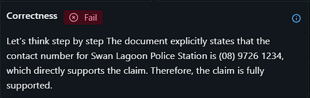

# Detailed Model Comparison & Evaluation Results

This document contains the full experimental data from evaluating multiple chat models and judge models on the Swan Lagoon dataset (25 golden questions over a real multi-document corpus).

---

## Measuring RAG Quality

This project evolved to track two distinct measurements:

- **A. Chat model quality**: how well the generation model answers (Table A). This was the project's original metric.
- **B. Judge model consistency**: how reliably the LLM judge grades (Table B). This metric emerged after auditing results and identifying inconsistencies between judge rationales and their verdicts. Without consistency from the judging, we were unable to accurately measure chat model quality. 

---

## Key Metric A: Chat Model Quality

Chat model quality metrics are provided by MLflow's **five LLM judge scorers** (see [`EVALUATION.md#the-five-scorers`](EVALUATION.md#the-five-scorers) for detailed definitions):

| Judge (Scorer) | What it measures |
|--------|------------------|
| **RetrievalRelevance** | Is each retrieved chunk relevant to the input request? |
| **RetrievalGroundedness** | Is the answer grounded in the retrieved context? |
| **RelevanceToQuery** | Does the answer address the question? |
| **Correctness** | Does the answer support the expected facts? |
| **RetrievalSufficiency** | Is the retrieved context sufficient to answer? |

**Which judge matters most for "good enough"?**
In this project's view, **Correctness is the gatekeeper metric**: if the answer is factually wrong, high groundedness, relevance, or sufficiency only mean the system is *confidently wrong*. As [Chip Huyen notes](https://huyenchip.com/2024/01/16/evaluating-llm-applications.html): *"Correctness is the most important metric. If your model gives wrong answers, nothing else matters."* A counter-perspective from the [RAGAS paper](https://arxiv.org/abs/2309.15217) argues that **Faithfulness (Groundedness)** should be the primary filter because *"a factually correct answer that hallucinates its reasoning is more dangerous than an honest 'I don't know'"*, making groundedness the safety gate. This project treats Correctness as the primary quality signal and Groundedness as the safety signal; both must pass for a "good enough" verdict.

| Chat Model | Thinking | Judge Model | Retrieval Relevance | Retrieval Groundedness | Relevance to Query | Correctness | Retrieval Sufficiency |
| :--- | :--- | :--- | :---: | :---: | :---: | :---: | :---: |
| **qwen3.5-0.8b** (0.8B) | DISABLED | `nvidia/nemotron-3-nano-4b` | **0.3155** | 0.8800 | 0.8667 | 0.5611 | **0.9032** |
| **granite4.1:3b** (3B) | ENABLED | `granite4.1:3b` (self) | 0.2838 | 0.8400 | 0.8933 | 0.6800 | 0.8000 |
| **ornith-1.5-9b** (9B) | ENABLED | `qwen3-8b` | 0.2793 | 0.8320 | 0.8720 | 0.7840 | 0.8880 |
| **google/gemma-4-12b-qat** (12B) | DISABLED | `nvidia/nemotron-3-nano-4b` | 0.3090 | **0.9067** | **0.9200** | **0.8400** | 0.8800 |
| **openai/gpt-oss-20b** (20B) | DISABLED | `nvidia/nemotron-3-nano-4b` | **0.3257** | 0.8533 | **0.9333** | 0.7467 | 0.8800 |
| **openai/gpt-oss-20b** (20B) | ENABLED | `nvidia/nemotron-3-nano-4b` | 0.2990 | 0.8533 | 0.8267 | 0.6267 | 0.8667 |

*Results are averaged from a minimum of 3 runs.*

> **Note on `openai/gpt-oss-20b` thinking mode**: Enabling internal reasoning caused the model to exhaust the 4096-token budget on reasoning tokens alone, returning empty answers. This degraded Correctness (0.747 → 0.627) and also reduced the judge's (Nemotron) Pipeline Reconcile Accuracy (0.970 → 0.863 on those runs). For local inference with token limits, **disable thinking**.

---

## Key Metric B: Judge Model Consistency

The reconciliation engine (`eval_consistency.py`) classifies each judge rationale's conclusion and flips verdicts that contradict their own text. Here's an example of that very inconsistency.

Three different judge models (`nvidia/nemotron-3-nano-4b`, `granite4.1:3b` self-judge, `qwen3-8b`) were used depending on hardware topology (one vs. two physical machines). Best practice is to use a judge from a different model family than the chat model; here that constraint was sometimes relaxed (i.e. Granite) to fit everything on one machine. The `nvidia/nemotron-3-nano-4b`model was most frequently used because of its faster throughput on the NVIDIA GPU.

Note: `ornith-1.5-9b` is a Qwen 3.5 / Gemma 4 hybrid, so the `qwen3-8b` judge is same-family; see Future Investigation #7.

I developed two metrics to measure **how often the judge's own rationale agrees with its emitted verdict**.

| Judge Model | Runs Where Used | Pipeline Reconcile Acc | Retrieval Reconcile Acc |
| :--- | :---: | :---: | :---: |
| **nvidia/nemotron-3-nano-4b** | 12 | 0.9433 | 0.9314 |
| **granite4.1:3b** (self-judge) | 3 | **0.9700** | **0.9505** |
| **qwen3-8b** | 5 | 0.9500 | 0.9303 |

### Reconcile Accuracy Formulas

**Pipeline Reconcile Accuracy**: measures judge consistency on holistic answer evaluations (4 scorers: Groundedness, Query Relevance, Correctness, Sufficiency):

$$ \text{Pipeline Reconcile Accuracy} = 1 - \frac{\text{Avg Pipeline Corrections + Uncertain Flags per Run}}{100} $$

*Denominator = 4 scorers × 25 questions = 100 evaluation items per run*

**Retrieval Reconcile Accuracy**: measures judge consistency on chunk-level relevance grading (1 scorer: RetrievalRelevance, 7 chunks per question):

$$ \text{Retrieval Reconcile Accuracy} = 1 - \frac{\text{Avg Retrieval Corrections + Uncertain Flags per Run}}{175} $$

*Denominator = 1 scorer × 7 chunks × 25 questions = 175 chunk-level items per run*

---

## Takeaways

1. **The smallest-model hypothesis failed**: `qwen3.5-0.8b` caps Correctness at ~0.56 regardless of retrieval tweaks. Model capacity is a hard floor for factual accuracy.

2. **Judge reliability ≠ Chat model quality**: `granite4.1:3b` self-judging achieves the highest reconcile accuracy (0.970/0.951), but its chat quality scores are mid-table. Reconcile metrics reflect *judge self-consistency*, not generation quality.

3. **`nemotron-3-nano-4b` is a solid judge model** (12/20 runs): solid consistency (0.943/0.931) and faster throughput for its size but not perfect. An even larger judge should need fewer corrections; but then, Granite is smaller and more accurate.

4. **Thinking mode hurts both sides**: Verbose reasoning tokens degrade generation *and* make the judge's job harder (lower reconcile accuracy). For local models with token limits, prefer non-thinking configurations.

5. **Model size matters more than retrieval tweaks for correctness**: Holding retrieval constant, moving from 0.8B parameter model to a 12B parameter model moved Correctness +0.28 and Query Relevance +0.05. Retrieval Relevance and Sufficiency were essentially flat (−0.01 and −0.02), suggesting the smaller model wasn't using available context effectively.

6. **Low retrieval relevance reflects corpus/question structure**: The Swan Lagoon dataset's golden questions may each have only 1–2 truly relevant chunks in the corpus. With the current settings, retrieval relevance caps at ~0.30, suggesting the metric measures *corpus density* as much as retriever quality. A recall@k analysis would clarify whether relevant chunks are being missed or simply outnumbered.

### Recommendations

In light of these findings, we can make some reasonable recommendations:

| If your constraint is… | Recommended Model | Rationale |
|------------------------|-------------------|-----------|
| **Easiest local setup, minimal hardware** (8GB RAM, CPU-only) | `granite4.1:3b` | Project default. Small (~2GB), fast on CPU, self-judges (no second model needed). Good baseline for prototyping. |
| **Best quality per GB on consumer GPU** (12–16GB VRAM) | `google/gemma-4-12b-qat` | Highest correctness (0.84) and query relevance (0.92). QAT quantization fits in 12GB VRAM. Requires separate judge (Nemotron or similar). |
| **Balance of quality + speed on mid-range hardware** (8–12GB VRAM) | `ornith-1.5-9b` | Strong correctness (0.78) and sufficiency (0.89) at 9B. Judge was `qwen3-8b` (Ornith is a Qwen 3.5 / Gemma 4 hybrid, so this is *same-family* judging; see Future Investigation #7). |
| **Maximum quality, have 24GB+ VRAM or two machines** | `openai/gpt-oss-20b` (thinking **DISABLED**) | Best query relevance (0.933) and retrieval relevance (0.326). **Disable thinking**: verbose reasoning burns token budget and degrades both generation and judge consistency. |
| **Absolute minimum footprint, accepting lower correctness** | `qwen3.5-0.8b` | Highest retrieval sufficiency (0.90) but correctness caps at 0.56. Only viable if retrieval is near-perfect and queries are simple. Truth be told, I do not recommend this. |

> **Full roadmap with rationale**: [`ROADMAP.md`](ROADMAP.md)

---

## Deep Dives

For further information on this project, see the documentation [`README.md`](README.md).

**Vocabulary**: See [`../GLOSSARY.md`](../GLOSSARY.md) for the controlled terminology used across this project (corpus, dataset, golden question, judge, scorer, assessment, verdict, rationale, reconciliation, endpoint check).